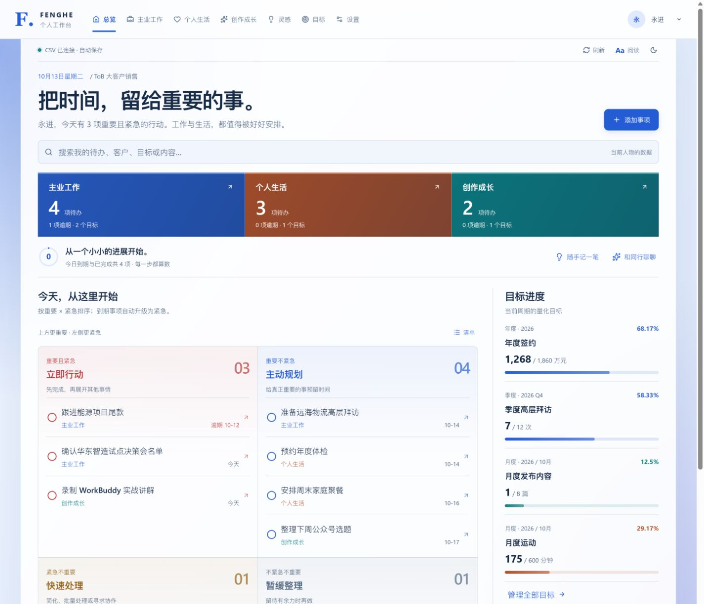
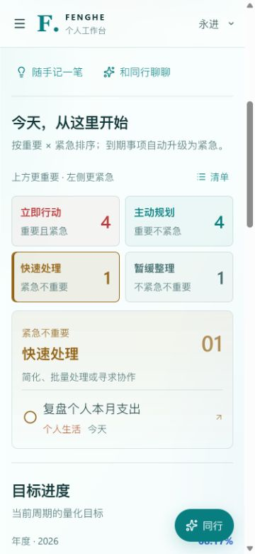
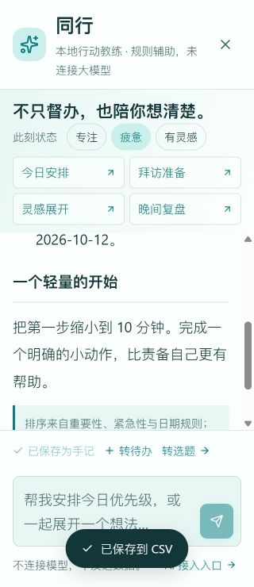

# Fenghe Sales Workbench

**A local-first personal workbench for B2B sales—connecting customers, opportunities, next actions, goals, life, and creative work.**

[简体中文](README.md) · English · [GitHub repository](https://github.com/jiyongjin/fenghe-sales-workbench)

Copyright © 2026 [风禾永进 (Fenghe Yongjin)](https://yongjin.tech) · [MIT License](LICENSE)

Know your next step. Capture ideas. See your progress. Run the application independently, or use a general-purpose agent with authorized file and terminal access to reproduce, customize, and maintain it. No particular agent product is required.



> Screenshots are historical captures with fictional demo data. Dates, settings, and progress may differ from a fresh installation. The application UI is currently primarily Chinese; this English README does not imply an English UI is implemented.

## Who it is for

- B2B salespeople, account managers, and independent consultants who want a clear next action.
- Individuals organizing professional work, personal life, and content creation in one place.
- People learning or demonstrating how agents can build a real local application from inspectable code and data contracts.

This is a personal, single-machine-first tool—not a multi-tenant team CRM, an account authorization system, or an enterprise approval platform.

## Features

| Area | Capabilities |
| --- | --- |
| Overview | Aggregated tasks, importance/urgency quadrants, daily progress, goals, and important dates |
| Sales work | Customer tiers, contacts, leads/opportunities/delivery, payments, visits, and marketing activities |
| Personal life | Finance, health, learning, family, and personal reviews |
| Creative work | Content from idea to publication and review; rename or disable this third workspace |
| Goals | Annual/quarterly/monthly targets, custom units, manual/record-based values, and attainment |
| Ideas | Ideas, reflections, and quick notes; read first, edit explicitly, turn notes into linked tasks or content drafts |
| Reviews | Daily/rolling-seven-day/month-to-date summaries, reading mode, explicit editing, saved versions, Markdown export |
| Appearance | Cloud/Aureum/Tide themes, light/dark modes, text size, density, backgrounds, and responsive layouts |
| Companion | Offline rule-based guidance for planning, visit preparation, idea structuring, and reflection |

**Companion is not a connected language model.** It uses local rules and makes no external model API calls. Real AI integration currently consists only of an informational entry point and a future integration checklist.

## Quick start

Install **Node.js 22.13+** and npm. Local validation used Windows and Node.js 24.13.0; not every operating system or Node version has been tested.

Clone or download this repository using GitHub's Code menu, then run from the project directory:

```shell
npm ci
npm run build:local
npm start
```

Open [http://127.0.0.1:4318/](http://127.0.0.1:4318/). The first launch creates 13 CSV files and fictional demo records in `data/`, without overwriting existing CSV files. Closing the foreground terminal stops `npm start`; the data remains on disk.

### Independent startup on Windows

After building once, double-click `启动个人工作台.cmd` to start, and `停止个人工作台.cmd` to stop. The launcher starts a separate Node process that does not depend on an agent session remaining open. Automatic startup at system boot is not configured.

If port 4318 is already occupied, choose another port for your copy rather than stopping an unrelated service:

```powershell
$env:WORKBENCH_PORT='4328'
.\启动个人工作台.ps1 -NoBrowser
```

`npm run dev` starts only the frontend development server, not the full CSV backend. Validate complete functionality using the built application and its same-origin Node service.

## Working with general-purpose agents

No agent is required to run the application. For reproduction and development, use an agent that has the necessary authorized local file and terminal tools. An agent that does not automatically discover project instructions can still be explicitly asked to read them.

Shared entry points:

- [AGENTS.md](AGENTS.md): engineering conventions and data/execution boundaries.
- [English guide](docs/AGENT_GUIDE.en.md) / [中文指南](docs/AGENT_GUIDE.zh-CN.md): running, reproducing, customizing, and validating the project.
- [Reusable prompts](docs/AGENT_PROMPTS.md): copyable task briefs.
- [Portable replication skill](skills/fenghe-workbench-replica/SKILL.md): code blueprint, data dictionary, visual references, and reproduction/verification scripts.

For example:

```text
Read README.en.md, AGENTS.md, and docs/AGENT_GUIDE.en.md first.
Use skills/fenghe-workbench-replica to reproduce this workbench in a new,
empty directory. Generate fictional demo data, run the checks, and report
actual results. Do not overwrite existing data, publish a website, expose
the service to a network, or connect an external model. Use only tools
that are actually available and authorized in your environment.
```

WorkBuddy, Codex, and Claude Code are examples of tools that may support such workflows. This repository does not claim dedicated connectors, universal automatic installation paths, or verified integrations with all of them. **Agent-assisted development does not mean the application is connected to those products' models.**

## Data, configuration, and backups

CSV files are the source of truth—not browser storage. See the [data dictionary](skills/fenghe-workbench-replica/references/data-dictionary.md) for fields and enumerations; the detailed schema and existing UI labels are primarily Chinese.

```text
data/
  profiles.csv    Profiles and appearance settings
  tasks.csv       Tasks, priorities, and source links
  goals.csv       Quantitative targets and periods
  customers.csv   Customer records
  projects.csv    Leads, opportunities, delivery, payments
  activities.csv  Visits and marketing
  finance.csv     Personal finances
  health.csv      Health records
  learning.csv    Learning records
  family.csv      Family matters
  content.csv     Content operations
  notes.csv       Ideas and reflections
  reviews.csv     Review text and saved versions
  assets/        User-uploaded backgrounds
  backups/       CSV backups made before writes
```

- UTF-8 CSV with BOM supports commas, quotes, and multiline fields.
- Writes create backups; revision checks guard against ordinary external overwrites. Referenced records must be unlinked before deletion.
- `user_id` groups records by profile; `note_id` links tasks/content back to a source note.
- Demo dates are relative to the current date in Asia/Shanghai. At the beginning of a month, some earlier publication/exercise records belong to the previous month; monthly attainment is not hardcoded to screenshot values.
- To migrate, stop the service and copy the complete `data/` directory, including `assets/` and `backups/`.

| Environment variable | Default | Purpose |
| --- | --- | --- |
| `WORKBENCH_PORT` | `4318` | Local port |
| `WORKBENCH_DATA_DIR` | Project `data/` directory | CSV and uploaded images; do not point it at real data casually |

No real operational data is included. `skills/.../assets/demo-fixture/` contains generated fictional snapshots; ordinary startup still generates fresh relative-date demos.

## Mobile and reading modes

Desktop uses a 2×2 matrix; mobile uses quadrant overview buttons and full-width actions. Body text defaults to 16px, with 15px standard and 18px large modes. Reduced-motion preferences are respected.

<p>
  
  
</p>

A responsive layout is not cross-device synchronization. A phone cannot access your computer's CSV files through the computer's `127.0.0.1` URL. Folder access depends on browser capabilities and permission. Without a connected directory or local service, the page is a preview and must not pretend that changes were saved.

## Privacy and current limitations

- The server binds only to `127.0.0.1` by default. There is no public account authentication or multi-tenant isolation; do not expose it directly as a public service.
- Profile switching is grouping, not account authorization. CSV is plaintext; masking personal preferences in the UI is not encryption.
- No built-in bank, wearable, publishing-platform, or calendar synchronization is provided.
- CSV is intended for personal single-machine use, not database-grade multi-user transactions or concurrency.
- Real AI is not connected. Do not upload customer, financial, health, or credential data to models or public issues.
- GitHub distributes the source. [GitHub Pages is static hosting](https://docs.github.com/en/pages/getting-started-with-github-pages/what-is-github-pages), so it cannot directly run this Node/CSV backend.

See [SECURITY.md](SECURITY.md).

## Development and verification

```shell
npm ci
npm run typecheck
npm test
npm run build:local
```

The existing 10 application tests cover CSV round trips, configuration compatibility, conflicts, relationships, profile scope, review periods, the rule-based coach, and HTTP writes. The replication skill also provides isolated end-to-end program checks:

```shell
node skills/fenghe-workbench-replica/scripts/replicate.mjs --target ../fenghe-sales-workbench-copy
node skills/fenghe-workbench-replica/scripts/verify-replica.mjs --target ../fenghe-sales-workbench-copy
```

Use a new empty directory and fictional data. Browser visuals and individual agent clients require separate validation; script success is not proof of either.

See [VALIDATION.md](docs/VALIDATION.md) for local results and [GITHUB_PUBLISHING.md](docs/GITHUB_PUBLISHING.md) for publication preparation. A local release directory is not evidence that a public repository already exists.

## Project layout

```text
components/workbench/  UI, themes, ideas, reviews, Companion
lib/                   Data model, CSV, offline rules
server/                Local HTTP and CSV storage
tests/                 Application tests
docs/                  Bilingual agent guides, prompts, screenshots
skills/                Portable replication skill and blueprint
AGENTS.md              Shared engineering instructions
README.md              Chinese documentation
LICENSE                Project MIT license
THIRD_PARTY_NOTICES.md  Third-party notices and dependency inventory
```

## Contributing and license

Copyright © 2026 **[风禾永进 (Fenghe Yongjin)](https://yongjin.tech)**.

Contributions to documentation, usability, data reliability, accessibility, and tests are welcome. Read [CONTRIBUTING.md](CONTRIBUTING.md), remove personal data, and run the checks before submitting changes.

Original project code and documentation are available under the [MIT License](LICENSE). Third-party dependencies retain their own copyrights and licenses; see [THIRD_PARTY_NOTICES.md](THIRD_PARTY_NOTICES.md). Fenghe is this project's name. References to other products do not imply official affiliation or endorsement.
