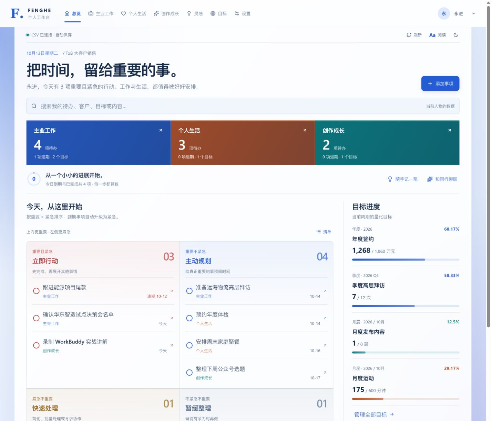
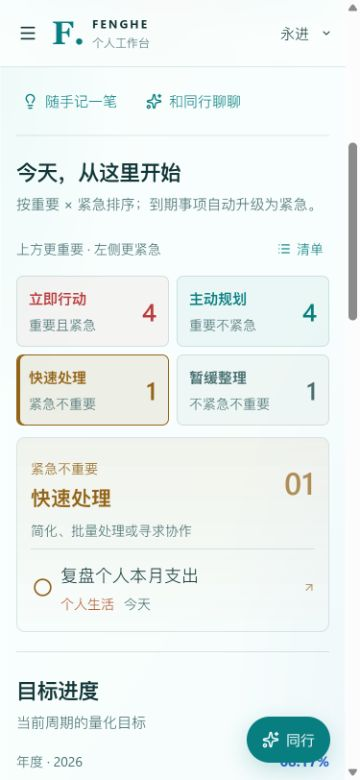
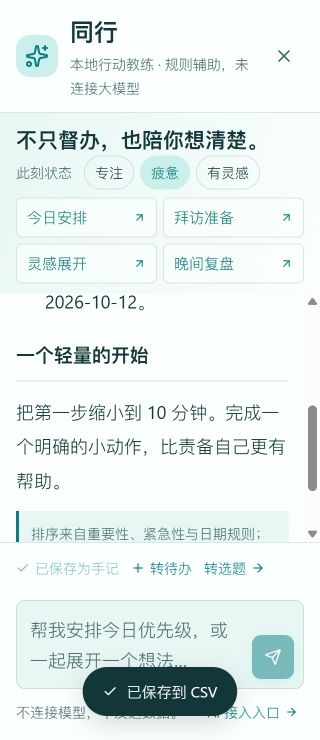

# Fenghe Sales Workbench

**面向 ToB 销售的本地优先个人工作台，把客户、商机、行动、目标、生活与创作连接起来。**

简体中文 · [English](README.en.md) · [GitHub 仓库](https://github.com/jiyongjin/fenghe-sales-workbench)

知道下一步，接住灵感，看见积累。程序可独立运行，也可交给具备文件和终端能力的通用智能体复刻、定制和维护，不绑定某一家智能体产品。



> 图片来自历史验收，均为虚构 DEMO；日期、主题和进度可能与今天首次生成的数据不同。当前应用界面以中文为主，英文 README 不代表已经提供英文界面。

## 适合谁

- 希望一眼看清客户、商机和下一行动的 ToB 销售、客户经理、独立顾问。
- 希望在同一工作台安排工作、生活和内容创作的个人用户。
- 希望通过源码和明确数据契约，学习或演示智能体开发本地应用的人。

这是个人单机优先的工具，不是面向团队的多租户 CRM，也不内置账号权限或企业审批系统。

## 主要功能

| 模块 | 能做什么 |
| --- | --- |
| 聚合首页 | 三空间待办、重要/紧急四象限、今日进展、目标与纪念日提醒 |
| 主业工作 | 客户分级、联系人、线索/商机/交付、回款、拜访和营销活动 |
| 个人生活 | 财务、健康、学习、家庭事项及生活复盘 |
| 创作成长 | 自媒体选题到发布/复盘的流程；第三空间可改名或关闭 |
| 目标管理 | 年/季/月目标、自定义单位、手动/自动达成值和达成率 |
| 灵感手记 | 灵感、心得、速记；先阅读后编辑，可转成有来源关联的待办或选题 |
| 复盘总结 | 日报/最近七天周报/月报、阅读优先、显式编辑、版本保存和 Markdown 下载 |
| 外观与阅读 | 云境/曜金/潮汐、日夜模式、字号/密度、背景图与遮罩、手机适配 |
| 同行 | 今日安排、拜访准备、灵感展开、晚间复盘的离线规则引导 |

**“同行”不是已连接的大模型。** 它使用本地规则，不调用外部模型 API；真实 AI 接入目前仅保留说明入口和后续清单。

## 快速开始

需要 **Node.js 22.13+** 和 npm。本次本地验证环境为 Windows、Node.js 24.13.0；并未在所有操作系统/Node 版本实测。

通过 GitHub 的 Code 菜单克隆或下载本仓库后，在项目目录执行：

```shell
npm ci
npm run build:local
npm start
```

打开 [http://127.0.0.1:4318/](http://127.0.0.1:4318/)。首次启动会在 `data/` 创建 13 张 CSV 和虚构 DEMO，不覆盖已有 CSV。关闭前台终端会停止 `npm start` 服务，数据仍保留。

### Windows 独立启动

完成一次构建后，双击 `启动个人工作台.cmd`；停止使用 `停止个人工作台.cmd`。启动器创建独立 Node 进程，不依赖智能体会话保持打开。没有设置开机自启动，电脑重启后需要再次启动。

如果4318端口已有程序运行，请为副本选择其他端口，不停止其他人的服务：

```powershell
$env:WORKBENCH_PORT='4328'
.\启动个人工作台.ps1 -NoBrowser
```

`npm run dev` 只是前端开发入口，不等于已启动真实 CSV 服务；完整功能验收请使用构建后的同源 Node 服务。

## 与通用智能体协作

程序运行不要求安装智能体。需要复刻、开发或维护时，可以使用任何获得授权、具备相应本地文件/终端工具的智能体；不支持自动读取规范的工具也可显式要求读取文件。

通用入口：

- [AGENTS.md](AGENTS.md)：工程约定、数据和执行边界。
- [中文协作指南](docs/AGENT_GUIDE.zh-CN.md) / [English agent guide](docs/AGENT_GUIDE.en.md)：启动、复刻、定制和验证方式。
- [通用任务提示词](docs/AGENT_PROMPTS.md)：可直接发送给智能体的任务模板。
- [标准复刻 Skill](skills/fenghe-workbench-replica/SKILL.md)：包含源码蓝本、数据字典、界面参考、复制与验收脚本。

例如：

```text
先阅读 README.md、AGENTS.md 和 docs/AGENT_GUIDE.zh-CN.md。
使用 skills/fenghe-workbench-replica 的规范，在新的空目录复刻工作台，
生成虚构 DEMO，执行测试并报告实际结果。不要覆盖原 data、发布网站、
开放局域网或连接外部模型；只使用你实际具备且已获授权的工具。
```

WorkBuddy、Codex、Claude Code 等可作为这类工具的示例；本项目没有为它们全部提供或实测专属连接器、自动安装路径或插件集成。**智能体辅助开发不等于工作台已接入这些平台的模型。**

## 数据、配置与备份

CSV 是主数据，不是浏览器缓存。完整字段和枚举见[数据字典](skills/fenghe-workbench-replica/references/data-dictionary.md)。

```text
data/
  profiles.csv    人物与外观设置
  tasks.csv       任务、优先级及来源关联
  goals.csv       量化指标与目标周期
  customers.csv   客户资产
  projects.csv    线索、商机、交付与回款
  activities.csv  拜访与营销
  finance.csv     财务
  health.csv      健康
  learning.csv    学习
  family.csv      家庭
  content.csv     自媒体运营
  notes.csv       灵感手记
  reviews.csv     复盘正文与版本
  assets/        用户上传背景
  backups/       写入前的CSV备份
```

- CSV 为 UTF-8+BOM，支持逗号、引号和换行。
- 写入前备份；revision 冲突检测防止普通外部覆盖；有关联的记录删除前要解除引用。
- `user_id` 用于人物分组；手记转行动/选题用 `note_id` 保留来源。
- DEMO 以生成时上海日期为基准；月初的发布/运动记录可能属于上月，月度达成率不会固定成截图中的数字。
- 迁移前停止服务，复制完整 `data/`，包括 `assets/` 和 `backups/`。

| 环境变量 | 默认值 | 用途 |
| --- | --- | --- |
| `WORKBENCH_PORT` | `4318` | 本机端口 |
| `WORKBENCH_DATA_DIR` | 项目下 `data/` | CSV和上传图片目录；不要随意指向真实资料 |

仓库不附带真实运行数据。`skills/.../assets/demo-fixture/` 仅包含从代码生成的虚构冻结样例，默认运行仍使用动态生成数据。

## 手机与阅读模式

桌面显示2×2矩阵；手机用象限概览切换完整行动。正文默认16px，提供15px标准与18px大字模式，并支持减少动态效果设置。

<p>
  
  
</p>

手机适配不等于跨设备同步。手机不能凭电脑的 `127.0.0.1` 地址读取电脑CSV；文件夹授权能力取决于浏览器。没有连接数据目录/本机服务时，页面只能预览，不能假装保存成功。

## 隐私与当前边界

- 服务默认只监听 `127.0.0.1`，没有公网账号、鉴权和多租户隔离，不应直接作为公网服务使用。
- 人物切换是分组，不是账号权限；CSV明文保存，敏感偏好默认遮挡不是加密。
- 不内置银行、穿戴设备、自媒体、日历等第三方平台的数据同步。
- CSV是个人单机方案，不提供多人数据库级事务和并发保证。
- 真实 AI 尚未连接；不要向模型或公开 Issue 上传客户、财务、健康明细与密钥。
- GitHub 负责源码分发；[GitHub Pages 是静态托管](https://docs.github.com/en/pages/getting-started-with-github-pages/what-is-github-pages)，不能直接运行本项目的 Node＋CSV 后端。

更多见 [SECURITY.md](SECURITY.md)。

## 开发与验证

```shell
npm ci
npm run typecheck
npm test
npm run build:local
```

现有10项程序测试覆盖CSV往返、配置兼容、冲突、关系保护、人物范围、复盘周期、规则教练及HTTP保存。复刻 Skill 另提供隔离的端到端程序验收：

```shell
node skills/fenghe-workbench-replica/scripts/replicate.mjs --target ../fenghe-sales-workbench-copy
node skills/fenghe-workbench-replica/scripts/verify-replica.mjs --target ../fenghe-sales-workbench-copy
```

请在新空目录验证，不把现用 `data/` 当测试数据。浏览器/不同智能体客户端兼容性须分别测试，不能以脚本通过代替视觉或客户端导入验证。

本次本地验证结果见 [VALIDATION.md](docs/VALIDATION.md)。源码发布范围与维护说明见 [GITHUB_PUBLISHING.md](docs/GITHUB_PUBLISHING.md)。本仓库用于源码分发，应用需要按上文在本机启动。

## 项目结构

```text
components/workbench/  界面、主题、灵感/复盘/同行
lib/                   数据模型、CSV、离线规则
server/                本机HTTP与CSV存储
tests/                 程序测试
docs/                  双语智能体指南、提示词、图片
skills/                可移植复刻 Skill 与蓝本
AGENTS.md              通用工程协作约定
README.en.md           英文说明
LICENSE                项目MIT许可证
THIRD_PARTY_NOTICES.md  第三方声明与依赖清单
```

## 参与与许可

欢迎从问题描述、文档、易用性、数据可靠性和可访问性改进开始。请先阅读 [CONTRIBUTING.md](CONTRIBUTING.md)，提交前移除个人数据并运行测试。

项目自有代码与文档采用 [MIT License](LICENSE)。第三方依赖保留各自版权和许可证，见 [THIRD_PARTY_NOTICES.md](THIRD_PARTY_NOTICES.md)。Fenghe 是本项目名称；提到其他产品仅为使用说明，不代表官方隶属或背书。
